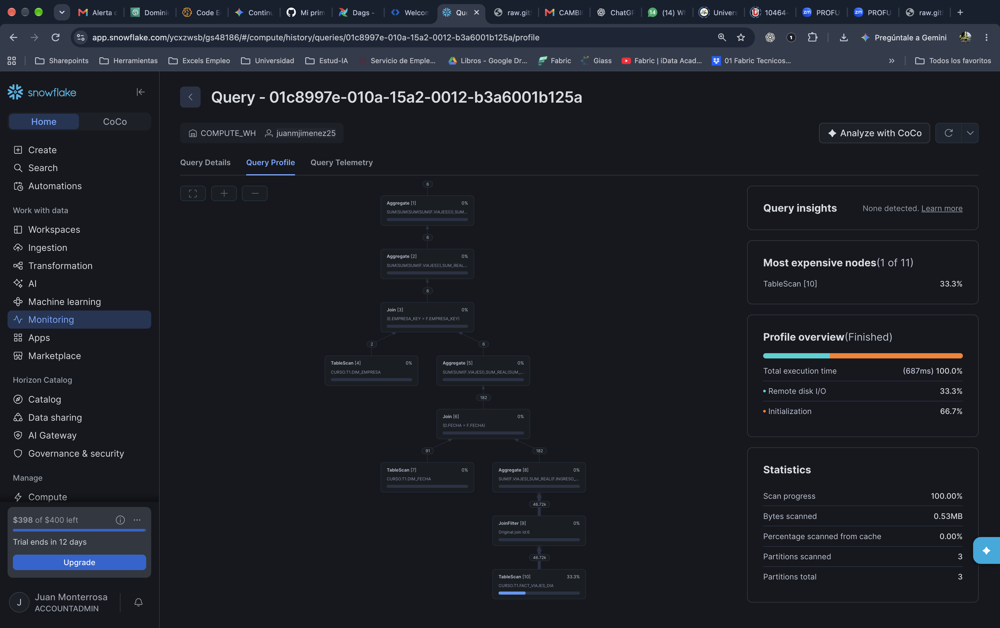

# Costos y rendimiento

Fecha de medición reportada por Snowflake: 2026-11-23.
Warehouse: COMPUTE_WH; suspensión automática configurada a 60 segundos.
Consumo observado desde CURRENT_DATE(): 0,1371 créditos.

El consumo incluye laboratorios y taller. No es el costo exclusivo
de A1 ni del Taller 1. La fecha depende de la zona horaria de la sesión
y el valor representa una captura puntual del consumo.

Se probaron A1 a A5 con USE_CACHED_RESULT=FALSE y la etiqueta
TALLER1_CASO_A_PERFIL. Después se restauró USE_CACHED_RESULT=TRUE.
Esto desactiva la reutilización de resultados, no todas las cachés.

La consulta con mayor tiempo total de la prueba fue:
SELECT * FROM CURSO.T1.A1;

Query ID: 01c8997e-010a-15a2-0012-b3a6001b125a.

| Fuente | Medida | Valor |
|---|---|---:|
| Query History | Tiempo total | 960 ms |
| Query History | Tiempo de ejecución | 189 ms |
| Query History | Bytes leídos | 1.306.624 |
| Query Profile | Tiempo mostrado | 687 ms |
| Query Profile | Datos leídos | 0,53 MB |
| Query Profile | Particiones leídas / total | 3 / 3 |
| Query Profile | Lectura desde caché | 0 % |

Las fuentes muestran cifras distintas. Se conservan identificadas
sin tratarlas como equivalentes; no se ha establecido la causa.

El perfil atribuye 66,7 % a inicialización y 33,3 % a lectura remota.
El operador más costoso es TableScan [10] de FACT_VIAJES_DIA.
Leer las tres particiones es coherente con consultar todo el trimestre.

No hay evidencia que justifique ampliar el warehouse para este volumen.
Se propone mantener X-Small y suspensión automática, agrupar el trabajo
de la sesión y filtrar por fechas cuando la pregunta lo permita.
No se recomienda introducir clustering sin medir una mejora.

