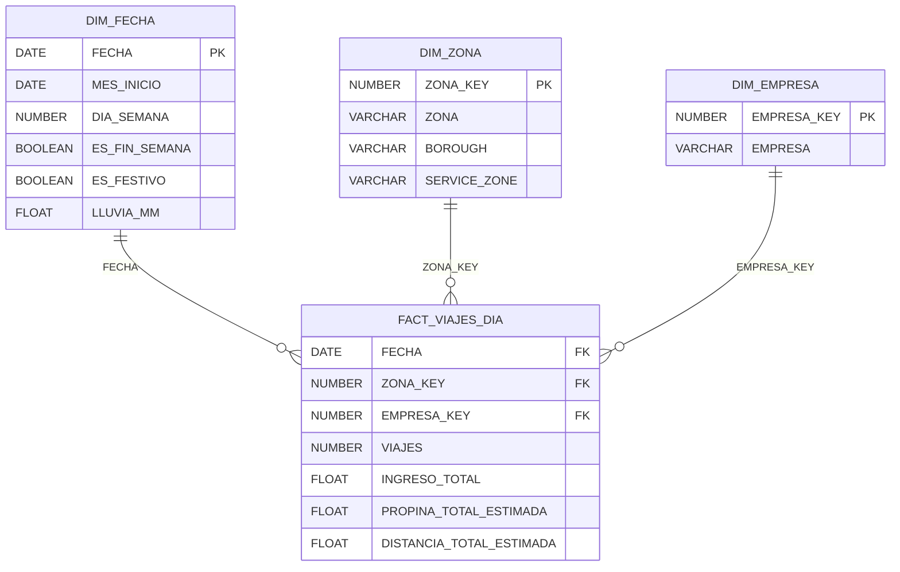

# Modelo estrella

Grano: una fila por fecha, zona y empresa.

Las claves del diagrama son lógicas y se comprueban mediante SQL.
La clave compuesta del hecho es (FECHA, ZONA_KEY, EMPRESA_KEY).
DIM_ZONA conserva una fila por nombre, distrito y tipo de servicio.
Las dimensiones y el hecho se reconstruyen juntos para mantener
la correspondencia de las claves.
